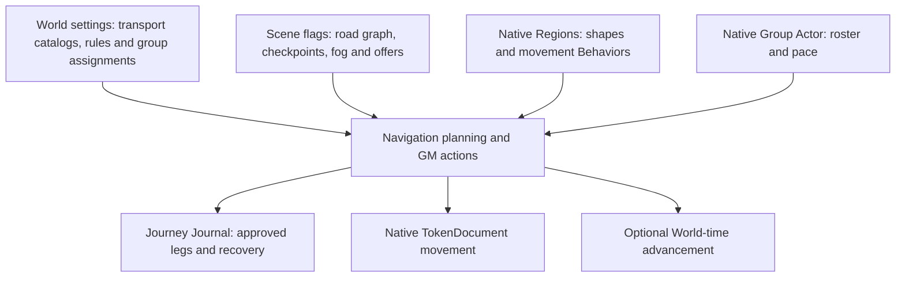

# Atlas Navigation — architecture stabilization baseline

**Source:** `v0.3.8-beta.7.4.4`, draft PR #142, pending live Foundry v14 GM/player acceptance.

**Purpose:** Define a safe architecture-only progression before new Navigation UX features. This document and its dependency tool do not change the installed Foundry runtime or any persisted schema. All work remains on stacked draft PRs until the owner accepts it.

## 1. Foundry document ownership



- **Authoring:** `atlas-model.js` / `road-model.js` own validation and topology; `atlas-storage.js` / `road-storage.js` own GM-checked Scene writes. Native Region geometry is never duplicated as an Atlas graph.
- **Travel:** `navigation-foundry.js`, `navigation-route.js`, `navigation-transport-transitions.js`, and time/rules helpers calculate previews independently of UI rendering. `navigation-controller.js` currently coordinates the resulting actions.
- **History:** `navigation-journey-journal.js` saves confirmed legs and final journey destination in a Journal, not a second Scene journey store. Opening a Journal must not move a token or replay time.
- **Discovery:** `player-visibility.js` projects revealed information for the player overlay; that visual filter is **not** a confidentiality barrier for raw Scene flags.
- **D&D5e:** Group sheet integration is explicitly guarded by system ID. A dedicated integration adapter is a later refactor; generic routing must stay system-neutral.

## 2. Actual source dependency inspection

The built-in tooling uses Node's standard library only, scans literal relative ESM imports/re-exports, and never loads Foundry globals or changes source files.

```sh
npm run architecture:check
node tools/architecture-graph.mjs --mermaid --focus navigation-controller
node tools/architecture-graph.mjs --json
```

The Mermaid output can be embedded in GitHub Markdown or used as input for a future interactive dependency explorer. `--focus` limits the graph to one matching module, its direct imports, and its direct importers.

At this baseline: **111 JavaScript source files; 358 file relationships; zero unresolved relative imports.** Two pre-existing cyclic groups are registered in `tools/architecture-cycle-baseline.json`:

1. `atlas-manual-fog-storage.js`, `atlas-map-fog-storage.js`, `party-exploration-storage.js`.
2. `checkpoint-preset-editor.js`, `checkpoint-preset-settings.js`.

The CI architecture job fails on *new* cyclic groups or broken relative imports without treating these existing groups as newly introduced regressions. The existing cycles are architectural debt to remove in separate tested slices, not permission to expand them.

**Beta.7.5 boundary slice:** Checkpoint Preset World reads have moved into
`checkpoint-preset-store.js`, which has no ApplicationV2 dependency. This removes
the second cycle above; only the fog/exploration storage cycle remains on the
current baseline. `checkpoint-preset-settings.js` re-exports the reader for
compatibility. No World setting or document schema changes.

**Beta.7.6 boundary slice (live GM/player acceptance passed):** A separately reviewed PR extracts the
read-only `readManualFog` and `readAtlasMapFog` functions into
`atlas-fog-readers.js`. This removes the final storage cycle; older modules
continue exporting the same functions. No fog flag writes, migration behavior,
GM privileges, geometry, history, or canvas refresh logic changes. The cycle
baseline is then empty, so CI rejects any new strongly connected component.

## 3. UI responsibility boundaries

| Layer | Owns | Must not own |
| --- | --- | --- |
| `ui/shared` (proposed) | Accessible buttons, tab controls, form rows, notices, shared CSS/tokens | Scene writes, GM privileges, token movement |
| GM Applications | Editable road/checkpoint/transport forms and Navigation decisions | Raw route algorithms or permanent UI state in Scene flags |
| Player presentation | Revealed roads, checkpoint markers, permitted Journal links | GM editing operations or hidden-record authority |
| Canvas adapter | PIXI graphics, pointer interactions, lifecycle cleanup | Journey business rules or persistent graph transformations |
| Domain/persistence | Validation, immutable projections, authorized document writes | Window styling, DOM creation, canvas effects |

The existing `settings-controls.js`, `settings-layout.js`, `settings-input.js`, `settings-select.js`, and `settings-close-guard.js` are useful shared foundations. We should extend them rather than replace them wholesale.

**Foundry-native UI direction:** Use v14 `ApplicationV2` and the optional Handlebars mixin/parts for multi-section windows; use reusable CSS and `data-action` handlers. Do not migrate high-risk Journey internals merely to change appearance.

## 4. Map-editing window behavior

1. Preserve current **modeless** GM authoring and the floating Road Editor dock. Edits stay staged until explicit Save/Finish; Cancel discards them.
2. Offer **Locate Road** when an editor has a spatial target: pan/zoom to and
   briefly highlight the *working*, potentially unsaved road. It does **not**
   minimize the editor. Native `ApplicationV2` title-bar minimization is a
   separate optional way to uncover more of the canvas. Never discard staged
   fields when locating, minimizing, or restoring.
3. For dialogs that must remain open during a map selection, keep click capture attached to the map with a visible contextual instruction. Respect Esc, Undo, Cancel, and native Foundry focus.
4. Standardize button labels, accessible names, tooltips, danger confirmation and minimum hit area; don't rely on ambiguous icons alone.
5. Avoid full-window rerenders for changes limited to progress text or a single footer button; profile before altering render behavior.

**Beta.7.5.2 correction (live GM acceptance passed):** The Road Editor dock
exposes **Locate Road**, using its unsaved geometry to pan/zoom and pulse the
corresponding road overlay. It leaves Save Points / Finish / Cancel available
without committing drafts. The earlier Focus Map/minimization interpretation
was incorrect. Icon parity with the Scene Atlas list is deferred to a later
UI-only milestone.

## 5. Small change sequence

1. **Architecture audit and safeguards (this slice):** This map, import graph, baseline cycle register, independent CI check, and tests. No runtime changes or version bump.
2. **Shared UI action foundation:** Introduce a reusable accessible icon/button helper and CSS, migrate a small subset of existing controls, add DOM-fake tests, and publish as a separate stacked PR.
3. **Map-focus UX:** Correctly locate/highlight the active unsaved road without
   closing or minimizing its editor (**accepted in beta.7.5.2**); standardize
   icon styling later without modifying the editing workflow.
4. **Decomposition:** Separate `navigation-controller.js` rendering from Journey coordination, and GM/editor canvas concerns from player overlay concerns. Preserve public interfaces and saved flags throughout.
5. **Regression safety net:** Reconcile tests with the current accessible UI
   and confirmed Journey-destination contract before further decomposition
   (**beta.7.7**, test-only changes).

**Beta.7.8 first Navigation decomposition slice:** The action-only footer is
now `navigation-footer.js`, with its own direct DOM regression tests. The
controller still calculates eligibility, renders the Journey body, performs
GM-authorized token movement and manages the clock/Journal state. The footer
receives a read-only eligibility snapshot plus the controller's existing
guarded action methods; merely rendering never commits a decision. The
controls, copy, button labels and callbacks are unchanged. This is an
architecture-only extract, not a new Journey feature or a schema update.

**Beta.7.9 next Navigation presentation slice:** Extract read-only distance,
travel time, total-trip, progress, in-world clock, speed, playback and terrain
summary display into a dedicated Navigation summary renderer, using values
already resolved by the controller. Calculation, GM action authorization,
clock/Journal writes and native TokenDocument movement stay in the controller.
The renderer may return element references for the existing progress and clock
updates, but never reads Foundry globals or registers actions. Preserve exact
copy, order and footer behavior in v14. The owner's future decisions regarding
Atlas-authored native Region boundaries and spatial checkpoint containment,
system-agnostic World calendar, and Scene-only import/export belong to later
feature stages. The inactive-GM movement policy remains on hold pending R-01.

**Beta.7.10 directions rendering slice (after beta.7.9 owner acceptance):**
Move the explanatory calculation text, Directions heading, endpoint cards,
route instruction cards and annotated Journey event cards into a separate
read-only directions view. The controller still selects, calculates and
formats the permitted current-leg steps; the view receives a plain, already
resolved model and registers no interactive events. Do not alter the
meaning of the original destination, checkpoint boundary, historical rest
or Continue March record, World time, TokenDocument movement or Journal
schema. Keep this on a separate stacked draft and test against the accepted
beta.7.9 live Journey behavior before merge.

**Beta.7.11 GM decision-prompt rendering slice (after beta.7.10 owner acceptance):**
Extract three read-only Journey notices into `navigation-prompts-view.js`:
daily travel-limit options, confirmed checkpoint arrival with distinct onward
and final-destination copy, and the repeated-arrival warning. The Navigation
controller still owns the daily travel rules, rest and forced-march wording,
checkpoint identity and terminal checks. The existing Footer owns all GM
buttons and callbacks. Rendering these notices cannot approve rest, advance
time, board transport, move a token, create a new leg, charge currency or
write Journal state. Preserve exact order and visible copy. This is a separate
stacked draft with no gameplay, permissions or persisted-schema changes.

**Beta.7.11.1 recovery hotfix after beta.7.11 owner redraw failure:** The
Journal already records a checkpoint-bound authorized transportation method,
arrangement, operation, speed, movement progress, rests and ultimate Point B.
On Canvas redraw, a fresh Navigation controller defaults to Walking; routing
before restoring that saved method can apply terrain weighting to a previously
mounted physical route and fail the approved endpoint guard. Extract a pure,
read-only saved-transport selection validator and apply it before rerouting
the interrupted leg. Continue to reject changed routes, checkpoints, surfaces
and missing methods; provide distinct guard failure reasons. Do not silently
select Walking, overwrite Journey authority, replay approved World-time or
rest events, rebook transport, patch native Canvas, or write on read. This
remains an adapter/application boundary correction, not a wholesale rewrite.
R-01 investigation of *why* Foundry redraws the Canvas is independent and
does not justify suppressing native teardown. Live GM/player v14 redraw and
recovery verification remains mandatory.

**Beta.7.11.2 checkpoint continuation follow-up:** The owner observed a
successfully recovered land-to-ship journey pause at Port Barthos after
automatic Canvas restart. A selected Point B near the same completed
checkpoint could still generate a new tiny water preview which the correct
duplicate-arrival guard blocked. Keep completed checkpoint arrival as an
explicit GM decision distinct from unfinished-leg automatic recovery. If the
first onward preview would rebook the last completed checkpoint, drop only
its transient end/route selection and request a different Point B. A GM may
reopen the confirmed checkpoint choices read-only from the paused Journal,
revalidating the Scene, Atlas revision, TokenDocument location and checkpoint
before any new action. No authority comes from a rendered UI notice. Saved
transport recovery validation is surface/method-neutral; completed arrivals
must not silently continue without a new GM decision. No schema or movement
changes, and no relaxation of duplicate-booking guards.

**Beta.7.12 transfer-preview presentation boundary (after beta.7.11.2 owner tests):**
Extract only the read-only current-leg frame, recovery explanation, approved
leg heading, road names, preformatted cost/time narration, validation warning,
checkpoint advisory, and optional future-leg GM preview to
`navigation-transfer-preview-view.js`. Keep transportation selectors,
recovered operating-schedule input, edit dialogs, pricing and method
calculations in the controller. The preview never requests transport,
books services, charges funds, confirms checkpoint arrival or creates a new
Journey leg. This prepares a reusable, read-only transfer summary for the
future player pamphlet without exposing GM actions or changing future-leg
approval semantics. Preserve exact copy, ordering and Foundry v14 behavior.

**Beta.7.12.1 completed-route action correction:** The owner confirmed a
multi-surface beta.7.12 Journey ended with a completed Journal and 100% progress,
but the saved final-leg route preview still rendered an actionable Play button.
The controller now records a transient `completedRoute` lock only after the
completed Journal checkpoint succeeds. The Footer hides movement/rest actions
for that finished preview, while New Route and Open Journey Journal remain
available. The guarded travel action independently refuses an old completed
preview. A deliberate new route calculation or Clear resets this UI lock.
No persisted schema, token movement, World-clock calculation or recovery
checkpoint logic changes. Owner GM/player v14 acceptance is still required;
the next decomposition slice must not depend on this hotfix before acceptance.

**Beta.7.13 GM selector presentation boundary (after beta.7.12.1 owner acceptance):**
`navigation-selection-view.js` now renders only the source selector (Map Point A
versus assigned party token), optional Refresh location button, current-leg
travel method grouped select, and the journey-only method edit button. It
receives resolved option groups, selected IDs and disabled state from the
controller, and forwards user-triggered events through injected callbacks.
It does not inspect Foundry documents or game settings and cannot recalculate
routes, approve a transport, move a token, edit an Actor or save any Journal
by rendering. The controller retains offer/ownership eligibility, unexpected
method fallback, selected arrangement, callbacks, transport rules, recovery,
time/fare estimates and all guarded writes. The checkpoint-specific selector
and old-Journal operating-schedule control are explicitly not part of this
slice. No saved schema, permission or Canvas lifecycle change.

## 6. Validation gates and known baseline

At untouched beta.7.4.4, the targeted `navigation-continuous-voyage.test.mjs` passes **12/12**, and the shared settings control/layout tests pass **8/8**. The repository-wide `npm run check` is **not green**: local baseline run reached 533 passes, six failures, one cancelled case and a 60-second timeout. Track that suite separately; do not claim a new architecture change caused or fixed its prior failures.

**Beta.7.7 update:** The six remaining full-suite assertions were found to
reference superseded UI text/accessible icon controls or the old assumption
that a resumed leg automatically replaces the Journal's original Point B.
The tests now assert the actual accessibility and explicit-destination
contracts. The repository-wide `npm test` completes with **556/556 passing**.
These are corrected regression expectations, **not** a runtime fix to travel
or Journal persistence; actual Foundry GM/player behavior still needs the
usual owner smoke tests after installing a new version.

Before changing Journey presentation or map authoring lifecycle, require targeted Node tests and actual Foundry v14 GM/non-GM acceptance covering Long Rest re-enablement, multi-leg travel, Canvas redraw recovery, preserved Journal/world time, fog, road/checkpoint rendering, and native window focus.

**Explicit exclusions:** No new transportation services, automatic Actor rests, feature milestones, Scene/Journal/Actor schema migrations, currency changes, or intercepting native Canvas teardown.

**Future-feature architecture boundary (November 4):** New owner requests and their cross-chat [milestone plan](FUTURE_FEATURE_MILESTONES.md) do not expand this beta.7.x stabilization scope. Prepare role-filtered read-only Journey projections, retain GM-authoritative action boundaries, and investigate the reported player-view travel stall when the GM window is inactive **before** player progress, camera follow or faster playback. No future-feature code or stored-data migration is authorized by this documentation.

## Technical references

- [Foundry v14 applications](https://foundryvtt.com/api/modules/foundry.applications.html)
- [Foundry v14 ApplicationV2](https://foundryvtt.com/api/v14/classes/foundry.applications.api.ApplicationV2.html)
- [Project architecture](ARCHITECTURE.md)
- [Current roadmap](ROADMAP.md)
