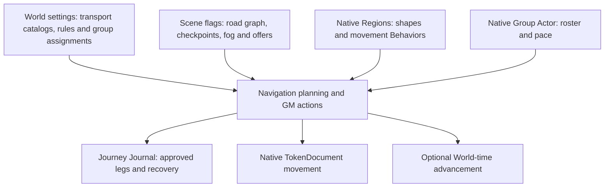

# Atlas Navigation — architecture stabilization baseline

**Source:** `v0.3.8-beta.7.4.4`, draft PR #142, pending live Foundry v14 GM/player acceptance.

**Purpose:** Define a safe architecture-only progression before new Navigation UX features. This document and its dependency tool do not change the installed Foundry runtime or any persisted schema. All work remains on stacked draft PRs until the owner accepts it.

## 1. Foundry document ownership



- **Authoring:** `atlas-model.js` / `road-model.js` own validation and topology; `atlas-storage.js` / `road-storage.js` own GM-checked Scene writes. Native Region geometry is never duplicated as an Atlas graph.
- **Travel:** `navigation-foundry.js`, `navigation-route.js`, `navigation-transport-transitions.js`, and time/rules helpers calculate previews independently of UI rendering. `navigation-controller.js` currently coordinates the resulting actions.
- **History:** `navigation-journey-journal.js` saves confirmed legs and final journey destination in a Journal, not a second Scene journey store. Opening a Journal must not move a token or replay time.
- **Discovery:** `player-visibility.js` projects revealed information for the player overlay; that visual filter is **not** a confidentiality barrier for raw Scene flags.
- **D&D5e:** Group sheet integration is explicitly guarded by system ID. A dedicated integration adapter is a later refactor; generic routing must stay system-neutral.

## 2. Actual source dependency inspection

The built-in tooling uses Node's standard library only, scans literal relative ESM imports/re-exports, and never loads Foundry globals or changes source files.

```sh
npm run architecture:check
node tools/architecture-graph.mjs --mermaid --focus navigation-controller
node tools/architecture-graph.mjs --json
```

The Mermaid output can be embedded in GitHub Markdown or used as input for a future interactive dependency explorer. `--focus` limits the graph to one matching module, its direct imports, and its direct importers.

At this baseline: **111 JavaScript source files; 358 file relationships; zero unresolved relative imports.** Two pre-existing cyclic groups are registered in `tools/architecture-cycle-baseline.json`:

1. `atlas-manual-fog-storage.js`, `atlas-map-fog-storage.js`, `party-exploration-storage.js`.
2. `checkpoint-preset-editor.js`, `checkpoint-preset-settings.js`.

The CI architecture job fails on *new* cyclic groups or broken relative imports without treating these existing groups as newly introduced regressions. The existing cycles are architectural debt to remove in separate tested slices, not permission to expand them.

**Beta.7.5 boundary slice:** Checkpoint Preset World reads have moved into
`checkpoint-preset-store.js`, which has no ApplicationV2 dependency. This removes
the second cycle above; only the fog/exploration storage cycle remains on the
current baseline. `checkpoint-preset-settings.js` re-exports the reader for
compatibility. No World setting or document schema changes.

**Beta.7.6 boundary slice:** A later, separately reviewed PR extracts the
read-only `readManualFog` and `readAtlasMapFog` functions into
`atlas-fog-readers.js`. This removes the final storage cycle; older modules
continue exporting the same functions. No fog flag writes, migration behavior,
GM privileges, geometry, history, or canvas refresh logic changes. The cycle
baseline is then empty, so CI rejects any new strongly connected component.

## 3. UI responsibility boundaries

| Layer | Owns | Must not own |
| --- | --- | --- |
| `ui/shared` (proposed) | Accessible buttons, tab controls, form rows, notices, shared CSS/tokens | Scene writes, GM privileges, token movement |
| GM Applications | Editable road/checkpoint/transport forms and Navigation decisions | Raw route algorithms or permanent UI state in Scene flags |
| Player presentation | Revealed roads, checkpoint markers, permitted Journal links | GM editing operations or hidden-record authority |
| Canvas adapter | PIXI graphics, pointer interactions, lifecycle cleanup | Journey business rules or persistent graph transformations |
| Domain/persistence | Validation, immutable projections, authorized document writes | Window styling, DOM creation, canvas effects |

The existing `settings-controls.js`, `settings-layout.js`, `settings-input.js`, `settings-select.js`, and `settings-close-guard.js` are useful shared foundations. We should extend them rather than replace them wholesale.

**Foundry-native UI direction:** Use v14 `ApplicationV2` and the optional Handlebars mixin/parts for multi-section windows; use reusable CSS and `data-action` handlers. Do not migrate high-risk Journey internals merely to change appearance.

## 4. Map-editing window behavior

1. Preserve current **modeless** GM authoring and the floating Road Editor dock. Edits stay staged until explicit Save/Finish; Cancel discards them.
2. Offer an **explicit Focus Map / Minimize** action on relevant windows, using public `ApplicationV2.minimize()` and native restoration. Never automatically close a window or discard unsaved fields when drawing starts.
3. For dialogs that must remain open during a map selection, keep click capture attached to the map with a visible contextual instruction. Respect Esc, Undo, Cancel, and native Foundry focus.
4. Standardize button labels, accessible names, tooltips, danger confirmation and minimum hit area; don't rely on ambiguous icons alone.
5. Avoid full-window rerenders for changes limited to progress text or a single footer button; profile before altering render behavior.

**Beta.7.5 pilot:** The Road Editor dock exposes **Focus Map**, which calls native
`ApplicationV2.minimize()` without changing a draft or saving it. A GM restores
the dock from its native window title bar before Save Points / Finish / Cancel.
The parent Scene settings sheet already minimizes when the road dock opens.
Live Foundry v14 GM testing must confirm that restored title bars remain
discoverable and map clicks are unobstructed.

## 5. Small change sequence

1. **Architecture audit and safeguards (this slice):** This map, import graph, baseline cycle register, independent CI check, and tests. No runtime changes or version bump.
2. **Shared UI action foundation:** Introduce a reusable accessible icon/button helper and CSS, migrate a small subset of existing controls, add DOM-fake tests, and publish as a separate stacked PR.
3. **Map-focus UX:** Pilot explicit minimize/restore in one GM editor while preserving unsaved inputs (**implemented in the separate map-focus draft PR**); verify with native Foundry v14 and only then generalize.
4. **Decomposition:** Separate `navigation-controller.js` rendering from Journey coordination, and GM/editor canvas concerns from player overlay concerns. Preserve public interfaces and saved flags throughout.

## 6. Validation gates and known baseline

At untouched beta.7.4.4, the targeted `navigation-continuous-voyage.test.mjs` passes **12/12**, and the shared settings control/layout tests pass **8/8**. The repository-wide `npm run check` is **not green**: local baseline run reached 533 passes, six failures, one cancelled case and a 60-second timeout. Track that suite separately; do not claim a new architecture change caused or fixed its prior failures.

Before changing Journey presentation or map authoring lifecycle, require targeted Node tests and actual Foundry v14 GM/non-GM acceptance covering Long Rest re-enablement, multi-leg travel, Canvas redraw recovery, preserved Journal/world time, fog, road/checkpoint rendering, and native window focus.

**Explicit exclusions:** No new transportation services, automatic Actor rests, feature milestones, Scene/Journal/Actor schema migrations, currency changes, or intercepting native Canvas teardown.

## Technical references

- [Foundry v14 applications](https://foundryvtt.com/api/modules/foundry.applications.html)
- [Foundry v14 ApplicationV2](https://foundryvtt.com/api/v14/classes/foundry.applications.api.ApplicationV2.html)
- [Project architecture](ARCHITECTURE.md)
- [Current roadmap](ROADMAP.md)
